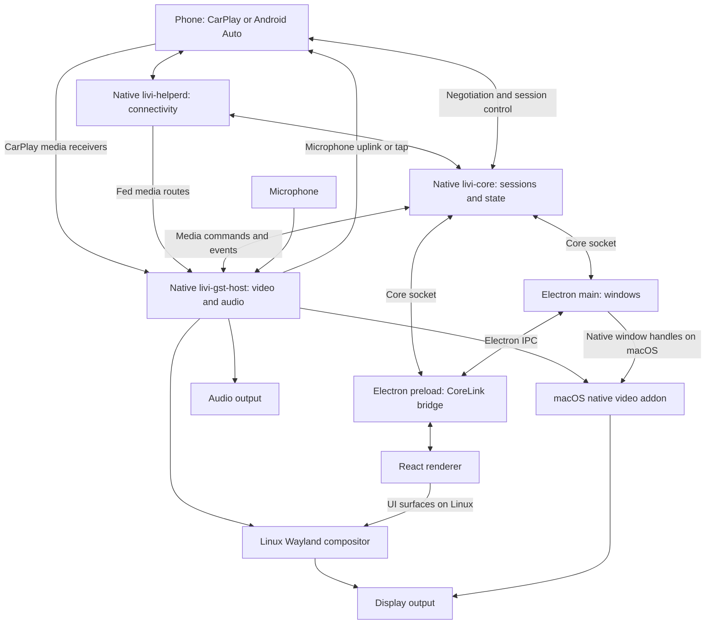

LIVI is an open-source Apple CarPlay and Android Auto head unit. This overview explains how its phone connections, native media services, and Electron interface fit together, and where you can start reading the implementation.

<Note>
This page describes the inspected `main` checkout of `kavia-aditi/LIVI-10000000883`, not the earlier v8.1.0 or v8.2.0 architecture. Source inspection confirms the relationships below; runtime behavior on specific hardware and release-tag equivalence remain unconfirmed. No hardware tests were run.
</Note>

## Main Components

LIVI separates application state and phone sessions from the graphical interface and media processing. In this checkout, the native Rust core owns projection orchestration. Electron main is not the phone protocol engine.

| Component | Responsibility | Source Location |
| --- | --- | --- |
| Native core (`livi-core`) | Loads configuration, publishes application state, manages phone sessions, and starts supporting processes | `native/livi-helperd/bin/livi-core/src/main.rs`, `services.rs`, and `projection.rs` in the same directory |
| Connectivity helper (`livi-helperd`) | Provides platform-specific connectivity and host operations, including wired-phone handling and Wi-Fi access-point operations | `native/livi-helperd/bin/livi-helperd/src/main.rs`, `linux_main.rs`, `mac_main.rs`, and `wired.rs` |
| CarPlay stack | Implements native CarPlay sessions, with supporting iAP2 and authentication crates | `native/livi-helperd/crates/livi-cp/`, `iap2-link/`, `iap2-csm/`, `iap2-mfi/`, `iap2-usbmux/`, and `iap2-wired/` under the same `crates/` directory |
| Android Auto stack | Implements Android Auto session management and protocol support | `native/livi-helperd/crates/livi-aa-stack/`, `livi-aa/`, and `livi-aa-proto/` |
| Media host (`livi-gst-host`) | Receives or consumes media feeds, controls video planes, plays audio, and handles microphone capture | `native/livi-gst-video/rust/host/src/` |
| Linux compositor | Combines the UI with native video output | `native/livi-compositor/rust/`; core integration in `native/livi-helperd/crates/livi-media/src/compositor.rs` |
| Electron main | Manages windows, connects to core configuration, and supplies Electron-specific operations | `src/main/index.ts`, `src/main/core.ts`, `src/main/window/`, and `src/main/ipc/` |
| Preload bridge | Exposes controlled native-core and Electron APIs to the renderer | `src/preload/index.ts` |
| React renderer | Displays settings, devices, media information, navigation, and dashboards | `src/renderer/src/`; core-backed state in `src/renderer/src/store/store.ts` |

The optional LIVI Link also has source in `native/livi-link/`. The README describes it as an external radio and authentication route. Its complete device-side flow is outside this overview.

## Component Diagram

The diagram separates control and state traffic from media traffic. Media does not need to pass through React or Electron IPC.

The media arrows summarize protocol-specific routes rather than one universal transport. In particular, Android Auto call audio can use the helper's Bluetooth SCO route; microphone taps can return through that helper rather than directly to the phone.

## From Phone Connection to Output

### 1. Start Services and Discover the Phone

`native/livi-helperd/bin/livi-core/src/main.rs` creates the state hub, loads configuration, binds the core socket, and starts background services. `services.rs` starts the connectivity helper, platform display integration, and UI supervision.

The README describes USB connections and wireless connections using Bluetooth pairing followed by a Wi-Fi session. Platform-specific helper entrypoints are `native/livi-helperd/bin/livi-helperd/src/linux_main.rs` and `mac_main.rs`; wired handling is in `wired.rs`.

### 2. Establish a Protocol Session

`native/livi-helperd/bin/livi-core/src/services.rs` constructs a CarPlay `StackCtx` and starts `livi_cp::manager`. It also starts `livi_aa_stack::manager` with an Android Auto media adapter and helper socket.

`native/livi-helperd/bin/livi-core/src/projection.rs` combines driver events, UI requests, device tracking, and active-session selection. This is the starting point for understanding which connected phone owns the visible projection and audible output.

### 3. Route Video into the Media Host

The CarPlay adapter in `native/livi-helperd/bin/livi-core/src/carplay.rs` delegates receiver creation to `GstHost::open_video_receiver`. The media host receives codec configuration and frames, then routes active video to the appropriate plane.

The Android Auto adapter in `native/livi-helperd/bin/livi-core/src/android_auto.rs` creates per-session feed routes targeting the main or cluster plane. The host processes those media records separately from the UI state connection.

Read `native/livi-helperd/crates/livi-media/src/gst_host.rs` for host commands and `native/livi-gst-video/rust/host/src/lib.rs` for receiver, feed, and active-stream dispatch. Video implementation is split among `native/livi-gst-video/rust/codec/`, `player/`, `screen/`, `nal/`, and `fanout/`.

### 4. Present Video on the Display

On Linux, `services.rs` starts the native compositor and follows its Wayland display information when configuring the media host. Plane placement and visibility are coordinated through `native/livi-helperd/crates/livi-media/src/planes.rs` and `compositor.rs`.

On macOS, there is no separate compositor in this startup path. `src/main/video.ts` loads `gst_video.node`, starts its control and UI-plane socket service, and associates screens with Electron native window handles. The media host hands frames to this native drawing path.

The README describes hardware-accelerated, zero-copy video. Whether a particular decoder, driver, and display achieves that behavior is **unconfirmed for your hardware**.

### 5. Play Audio and Return Microphone Input

CarPlay's `GstMedia` adapter opens audio receivers and microphone uplinks through the media host. Android Auto's `GstAaMedia` adapter manages audio outputs and fed routes. For Android Auto calls, `android_auto.rs` also sets a helper SCO sink and opens a microphone tap.

The host owns speaker, uplink, and tap objects in `native/livi-gst-video/rust/host/src/lib.rs`. Related implementations are in `native/livi-gst-video/rust/audio/`, `audioplayer/`, and `mic/`. Output-device changes are followed by `follow_audio_output` in core `services.rs`.

## Communication Boundaries

### Renderer to Native Core

`src/preload/index.ts` exposes `window.core.connect` through Electron's `contextBridge`. Its `CoreLink` opens a Unix-domain socket directly to the native core. The renderer does not send every core action through Electron main.

`src/main/shared/core/link.ts` resolves `core.sock`, sends a protocol handshake, and reconnects after disconnection. `src/main/shared/core/wire.ts` frames each JSON message with a four-byte little-endian length prefix.

`src/main/shared/core/contract.ts` contains the generated TypeScript contract. Messages include:

- **Client requests:** handshake, actions, input, resynchronization, and subscription controls.
- **Core responses:** initial state, revisioned patches, action replies, and spectrum data.

`src/renderer/src/store/store.ts` uses `CoreSession` to apply state updates to Zustand stores and send settings, device, media, and input actions. The native server and state hub are in `native/livi-helperd/bin/livi-core/src/server.rs` and `hub.rs`. Native protocol definitions live in `native/livi-helperd/crates/livi-core-proto/`.

### Renderer to Electron Main

Electron IPC remains for desktop-specific functions. `src/preload/index.ts` exposes version queries, custom-page URLs, user-activity notifications, media-key broadcasting, and a macOS cluster repaint request. Handler registration lives in `src/main/ipc/`.

`src/main/core.ts` independently subscribes to core configuration so Electron can manage its windows. It can start the native core on macOS if none answers; the source documents the reverse startup order on Linux, where core starts the UI.

### Core to Native Media and Display Services

`native/livi-helperd/crates/livi-media/src/gst_host.rs` manages `gst.sock` and binary media-host commands. Media feed records use a separate feed route, while `native/livi-host-proto/rust/` supplies the host framing and media record definitions.

Display control uses `compositor.ctrl`. On Linux it targets the compositor; on macOS the video addon serves the corresponding control interface. Do not confuse this binary media/control protocol with the JSON UI/core socket.

## Suggested Source Reading Order

1. `README.md`: product capabilities and supported connection modes.
2. `native/livi-helperd/bin/livi-core/src/main.rs` and `services.rs`: startup and process ownership.
3. `native/livi-helperd/bin/livi-core/src/projection.rs`: session events and active-phone selection.
4. `carplay.rs` and `android_auto.rs` in that same directory: protocol-to-media adapters.
5. `native/livi-helperd/crates/livi-media/src/gst_host.rs` and `native/livi-gst-video/rust/host/src/lib.rs`: media control and dispatch.
6. `src/preload/index.ts`, `src/main/shared/core/`, and `src/renderer/src/store/store.ts`: UI state and action flow.
7. `src/main/video.ts` or `native/livi-compositor/rust/`: platform-specific display integration.

<Warning>
  Older paths such as `src/main/services/projection/` are absent from this inspected checkout. Use the Rust core and crate paths above for the current architecture; do not apply this map to older releases without checking their source.
</Warning>
